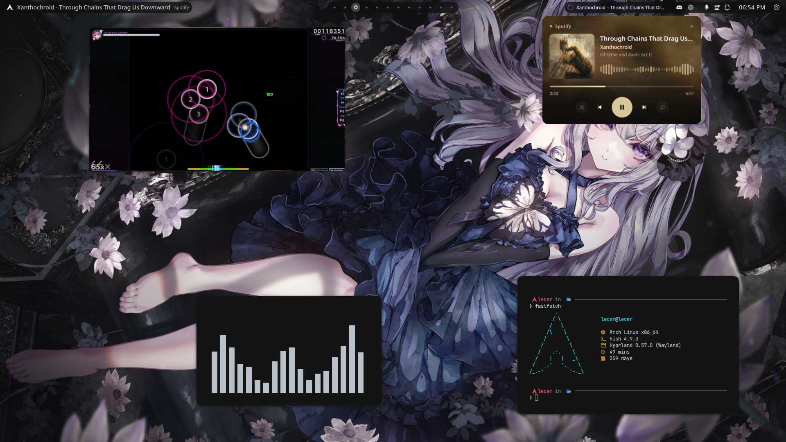

# Lecer's dots-hyprland

My personal Hyprland dotfiles using quickshell. (fast and lightweight)

<p align="center">
  
</p>

<details>
<summary><b>▶ Watch the video preview</b></summary>

https://github.com/user-attachments/assets/e4b28459-381c-448e-9042-47d1eca1bd22

</details>

> ## 🔴 THIS ONLY WORKS ON ARCH BASED DISTROS 🔴
> ### This setup is built exclusively for **Arch Linux AND Arch-based distros** and will **NOT** work on any other distribution.

> ## ⚠️ Not beginner-friendly
> This is my personal config, shared as-is. It can have bugs and unfinished bits, and I'm not always active, so updates and fixes can take a while. If you're not comfortable troubleshooting Hyprland/Quickshell issues yourself, this probably isn't for you, and in the future I'm not going to add other distro supports, it only supports Arch-based distros as I mentioned above.

## Features

Everything here is one Quickshell config (`lis`), so there's no separate bar, launcher, notification daemon or lock screen to run. Press `Super + /` to see every keybind.

### Shell

- **Bar**: can sit on any edge of the screen. Workspaces show as dots or numbers, and you can hide the ones that belong to other screens. The clock, color picker, screenshot, game mode, Bluetooth and network buttons can each be turned off. The pills have their own color, border and blur, and tray and workspace icons can be tinted with the accent color.
- **Launcher** (`Super + Tab`): app search. Start with `:` for clipboard history (`Super + V`) or `;` for emojis (`Super + .`).
- **Workspace overview** (`Alt + Tab`): live previews of your workspaces in a grid, with configurable rows, columns, scale and order.
- **Widget overlay** (`Super + J`): a big clock with your to-dos, system stats, today's screen time, data used and calendar notes, and what's playing.
- **Media player**: colors from the album art, an animated background, an audio visualizer, a seek bar and shuffle/repeat.
- **Notifications**: popups with a timeout you can set, shown on the focused monitor or only on the main one, plus a notification center with history (`Super + O`).
- **Volume and brightness**: scroll on the hover bars at the screen edges, with on-screen popups. Brightness works on external monitors through `ddcutil` and falls back to `brightnessctl`.
- **Lock screen**: blurred wallpaper with adjustable blur, caps lock and keyboard layout indicators, and it mutes your microphone while locked. It can skip vertical screens and also locks when you log in.
- **Idle**: lock, screen off and suspend timers set from the settings, plus an idle inhibit button on the bar.
- **Screenshots**: region (`Super + Shift + S`, the screen freezes while you select), current monitor (`Print`) and all monitors (`Ctrl + Print`).
- **Power menu** (suspend, reboot, shut down, exit) and a built-in **polkit** password prompt.

### Menu

The gear button at the end of the bar opens a menu with these panels:

- **Organize**
  - **Calendar**: notes for any day, including yearly ones.
  - **To-do**: tasks sorted into lists.
  - **Goals**: goals with subgoals.
  - **Notes**: searchable notes. Private notes stay hidden until you choose to show them.
- **Activity**
  - **Notification Center** (`Super + O`)
  - **Wellbeing** (`Super + Y`): screen time per app.
  - **Internet Usage** (`Super + N`): network traffic per app.
- **Devices**
  - **Audio**: output and input devices, and the volume of each app that's playing or recording.
  - **Bluetooth**: your devices and available ones.
  - **Network**: Wi-Fi and wired connections.
  - **Displays**: resolution, refresh rate, scale, rotation, variable refresh rate, 10-bit color and wallpaper per monitor. It reverts unless you choose to keep the change.
  - **Color Settings** (`Super + G`): brightness, contrast, saturation and gamma, with presets you can save.
- **System**
  - **Task Manager**: CPU, GPU, memory, disk and network usage, and you can search, end or kill processes.
  - **Battery & Power**: battery health and power profiles.
  - **Settings**

### Settings (`Super + Esc`)

- **General**: accent color and Material You color scheme, notifications, usage tracking and workspace overview layout.
- **Bar**, **Lock**, **Idle** and **osu!**: everything described above.
- **Cleanup**: shows the size of and clears the pacman cache (keeping as many versions as you choose), core dumps, the AUR build cache, the trash, thumbnails and Quickshell crash reports.
- **Dots Updater**: shows your version, the latest one and the recent commits, and updates your Hyprland config and the shell. It can back up your configs first and leaves your own files (`hypr/custom`, monitors, workspaces, wallpaper) alone.

### Theming

Pick an accent color and a scheme (tonal spot, vibrant, expressive, rainbow, fruit salad and more), and [matugen](https://github.com/InioX/matugen) colors the shell, Hyprland, GTK 3/4 apps, and KDE/Qt apps through kde-material-you-colors.

### osu!

While you play, notifications can be turned off and the other monitors fade to dark.

### Also included

Configs for fish, kitty, fastfetch, btop and mpv.

## Installation

```bash
git clone https://github.com/Lecer69/dots-hyprland.git
cd dots-hyprland
bash install.sh
```

Choose the **install** option from the menu, or run `bash install.sh --install`. It asks all its questions first, then installs on its own. `bash install.sh --help` lists the other options, like `--yes` to install without any questions. The packages it installs are listed in `packages/`, and the output of each run is saved to `~/.cache/dots-hyprland/install.log`.

## Updating

```bash
cd dots-hyprland
git stash && git pull && bash install.sh --update
```

It also offers to install packages that newer versions of the dots need. You can also try the updater in the settings, which tells you about missing packages but doesn't install them.

## Thanks

- [Quickshell](https://quickshell.org/) — the toolkit that makes this whole shell possible
- [end-4's dots-hyprland](https://github.com/end-4/dots-hyprland) — inspiration for this setup
- [Wallpaper](https://donmai.moe/posts/6470635) — wallpaper by naokomama
- [Wallpaper on preview](https://www.pixiv.net/en/artworks/147357244) — wallpaper preview by MISSILE228
