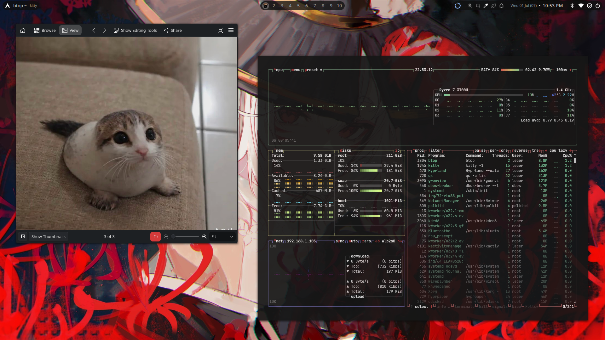
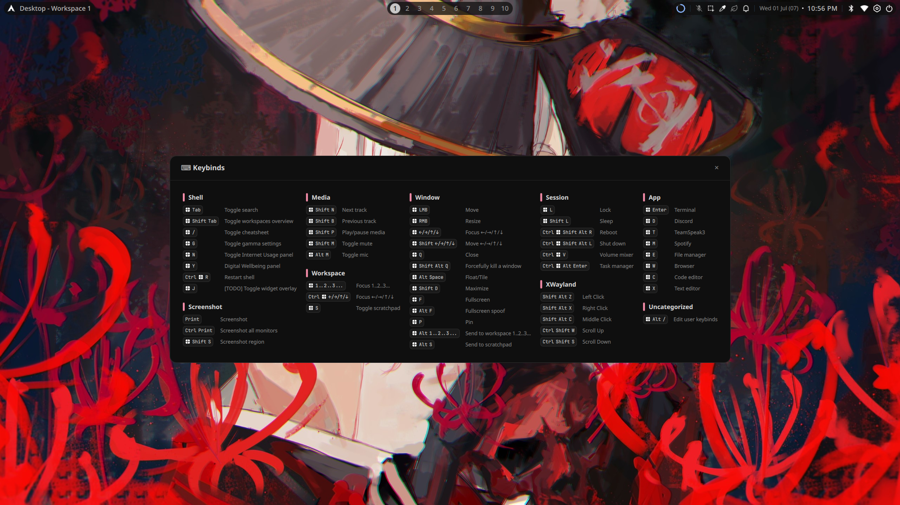
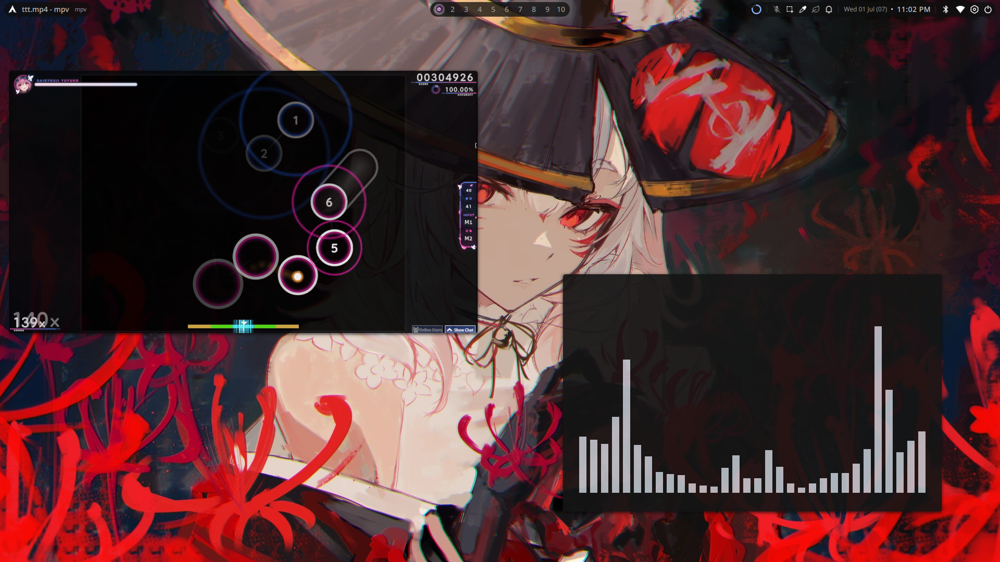
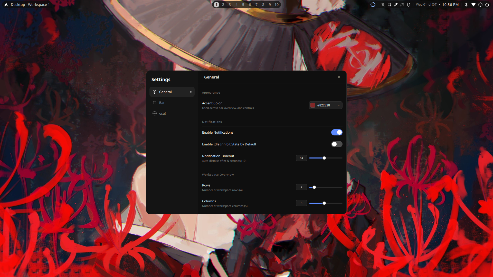

# Lecer's dots-hyprland

My personal Hyprland dotfiles using quickshell. (fast and lightweight)

> ## 🔴 THIS ONLY WORKS ON ARCH BASED DISTROS 🔴
> ### This setup is built exclusively for **Arch Linux AND Arch-based distros** and will **NOT** work on any other distribution.

> ## ⚠️ Not beginner-friendly
> This is my personal config, shared as-is. It can have bugs and unfinished bits, and I'm not always active, so updates and fixes can take a while. If you're not comfortable troubleshooting Hyprland/Quickshell issues yourself, this probably isn't for you, and in the future I'm not going to add other distro supports, it only supports Arch-based distros as I mentioned above.

## Installation

```bash
git clone https://github.com/Lecer69/dots-hyprland.git
cd dots-hyprland
bash install.sh
```

Choose the **install** option from the menu, or run `bash install.sh --install`. It asks all its questions first, then installs on its own. `bash install.sh --help` lists the other options, like `--yes` to install without any questions. The packages it installs are listed in `packages/`, and the output of each run is saved to `~/.cache/dots-hyprland/install.log`.

## Updating

```bash
cd dots-hyprland
git stash && git pull && bash install.sh --update
```

It also offers to install packages that newer versions of the dots need. You can also try the updater in the settings, which tells you about missing packages but doesn't install them.

## Screenshots

The screenshots are a little bit outdated.

<p align="center">
  
  
  
  
</p>

## Thanks

- [Quickshell](https://quickshell.org/) — the toolkit that makes this whole shell possible
- [end-4's dots-hyprland](https://github.com/end-4/dots-hyprland) — inspiration for this setup
- [Wallpaper](https://donmai.moe/posts/6470635) — wallpaper by naokomama